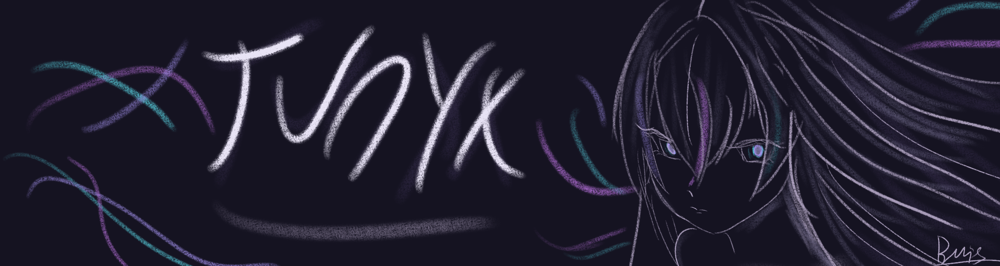

<div align="center">



---


### _Tune your experience._ 🎧

Upload your songs, build playlists, and watch a full-window equalizer react to the real audio spectrum.

**Build: Beta v1** · November 2026


</div>

---

## ✨ What is this?

Tunyx is a web music player we built as a group project for **Sistem Basis Data** and **UI/UX Design**. It started as a Java app in semester 2 and came back as a full web app with a dark, game-like interface.

No streaming catalog and no subscriptions: you upload your own songs and they become your library.

> 🧪 **This is a prototype, not a full-blown web app.** There is no real streaming service behind it. Songs are uploaded and played straight from the server's own `uploads/` folder, and it is built to run locally on XAMPP. It works end to end, but it is a Beta v1 made to show the idea and the experience, not to be deployed to the public.

## 🔥 Features

- 🔐 **Accounts:** register, sign in and out, change your username and profile photo (PHP sessions, bcrypt passwords)
- ⬆️ **Upload:** MP3, FLAC, WAV, OGG, M4A or AAC up to 100 MB, with title, artist, album, genre and cover. Mark a song public or private
- 🔎 **Browse and search:** Home, Explore, Library, Liked Songs, My Uploads, and live search by title, artist or genre
- 📚 **Playlists:** create, rename, change the cover, add and remove songs, delete
- ▶️ **Player:** queue panel (Up next), previous/next, volume, shuffle on playlists, a glowing seek line you can click, drag or move with the arrow keys, and `Space` to play or pause
- 🌈 **The visualizer:** 64 bars on the Web Audio API with the bass on the right, bars that swell on every kick, and a color gradient that keeps moving. The bars also light up as the song progresses

## 🧰 Tech stack

| Layer | What we used |
|---|---|
| Server | Apache + PHP 8, plain JSON endpoints in `api/` (PDO + sessions) |
| Database | MySQL (MariaDB via XAMPP), database `tunyx`, 8 InnoDB tables |
| Frontend | Vanilla JS ES modules, no build step, hash router, CSS design tokens |
| Audio | HTML `<audio>` + Web Audio `AnalyserNode`, drawn on a canvas |
| Look | Figma, Lucide icons, Sora + Inter fonts |

## 🚀 Run it locally

You need [XAMPP](https://www.apachefriends.org/).

1. Copy this project to `C:\xampp\htdocs\tunyx`.
2. In `php.ini` (XAMPP Control Panel > Apache > Config), set:
   ```ini
   upload_max_filesize=100M
   post_max_size=110M
   ```
3. Start **Apache** and **MySQL** in XAMPP (restart Apache if you edited `php.ini`).
4. Open phpMyAdmin (`http://localhost/phpmyadmin`) and import `db/mainschema.sql`. It creates the `tunyx` database and every table.
5. Go to **http://localhost/tunyx/**, create an account, and upload a few songs. A fresh clone starts empty.

The DB connection lives in `api/db.php` (`127.0.0.1`, user `root`, no password, database `tunyx`). Change it there if your setup is different. The `uploads/` folder is created automatically on your first upload.

> 💡 **For the visualizer:** click anywhere on the page once, then press play. Browsers only start Web Audio after a click.

> 🌐 The fonts come from Google Fonts, so you need internet for the full look.

<details>
<summary><b>Offline UI preview (?mock=1)</b></summary>

`http://localhost/tunyx/?mock=1` runs the interface on built-in sample data, with no PHP or MySQL. It is only a quick look at the UI: uploads and some account features don't work in this mode.

</details>

## 🗄️ Database

Eight tables, matching our ERD:

`users` · `artists` · `albums` · `tracks` · `playlists` · `playlist_tracks` · `likes` · `play_history`

Cascading deletes keep things clean: removing a user, track or playlist also removes its likes, history and playlist entries. Deleting an album only clears `tracks.album_id`. The full schema (keys, indexes, constraints) is in [`db/mainschema.sql`](db/mainschema.sql).

## 📁 Project structure

```
index.php              single page shell
api/                   PHP JSON endpoints (login, songs, upload, playlists, ...)
db/mainschema.sql      database schema
assets/css/            design tokens + one stylesheet per component
assets/js/
  main.js, router.js   boot, layout, hash routing
  api.js, store.js     fetch wrapper and shared state
  player.js            the single audio element, queue and history
  components/          sidebar, top bar, player bar, modals, visualizer, ...
  views/               home, explore, library, liked, uploads, playlist, now playing
uploads/               songs, covers, avatars (created at runtime, not in git)
```

## 🔌 API at a glance

Every endpoint answers `{ success, message, data }` with a matching HTTP status. Everything except `login` and `register` needs a signed-in session (otherwise 401).

| Endpoint | What it does |
|---|---|
| `register.php` `login.php` `logout.php` `me.php` | accounts and session |
| `profile.php` | change username or profile photo |
| `songs.php` | list and search (`q`, `genre`, `liked`, `mine`); POST `delete` removes your own song |
| `upload.php` | upload a song (multipart) |
| `like.php` | toggle a like |
| `playlists.php` | list, create, rename, change cover, delete |
| `playlists_tracks.php` | songs in a playlist: list, add, remove |
| `history.php` | record, list and clear play history |
| `albums.php` | list albums and details (not used by the UI) |

## 🩹 Troubleshooting

| Problem | Fix |
|---|---|
| "Can't reach the server" | Start Apache, and open the app through `http://localhost/tunyx/` |
| "Could not connect to the database" | Start MySQL and make sure `db/mainschema.sql` was imported |
| Upload fails on a big file | Check the `php.ini` limits in step 2, then restart Apache |
| Visualizer doesn't move | Click the page once, then press play |
| Layout feels cramped | It's designed for a 1440 px wide window. Under 1100 px the sidebar collapses and Up next becomes a drawer |

## ⚡ Fun fact

Tunyx was speedrun on a **2-week deadline**: concept, Figma design, database, PHP backend, frontend and the visualizer, all in two weeks.

## 🙏 Special thanks

| Name | Role | Profile | 
|---|---|---|
| **Bris** | Project Lead · UI/UX Designer · Frontend Developer | [@brisisfr](https://github.com/brisisfr) | 
| **krabbyforry** | Lead Backend & Database Engineer | [@krabbyforry](https://github.com/krabbyforry) |
| **K**  | UI/UX Contributor · Documentation | - |
| **F**  | UI/UX Contributor · Documentation | - |
| **P**  | Documentation Lead | - |

<div align="center">

Made with way too much caffeine 💜

</div>
