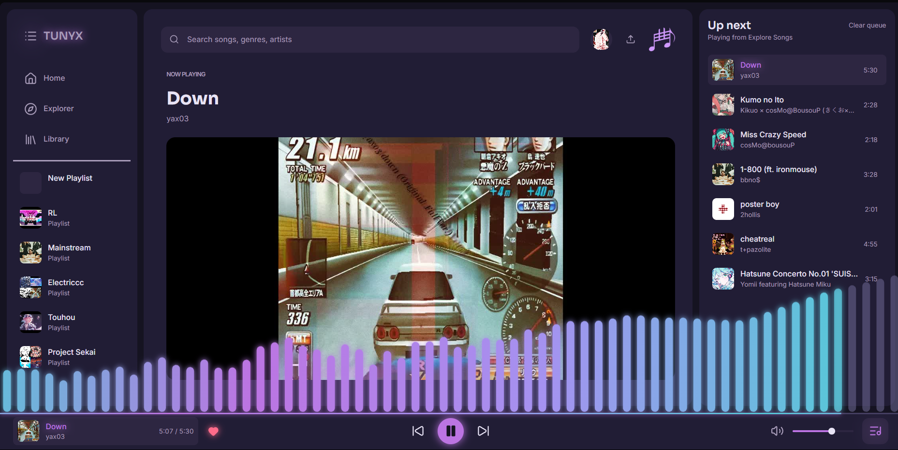
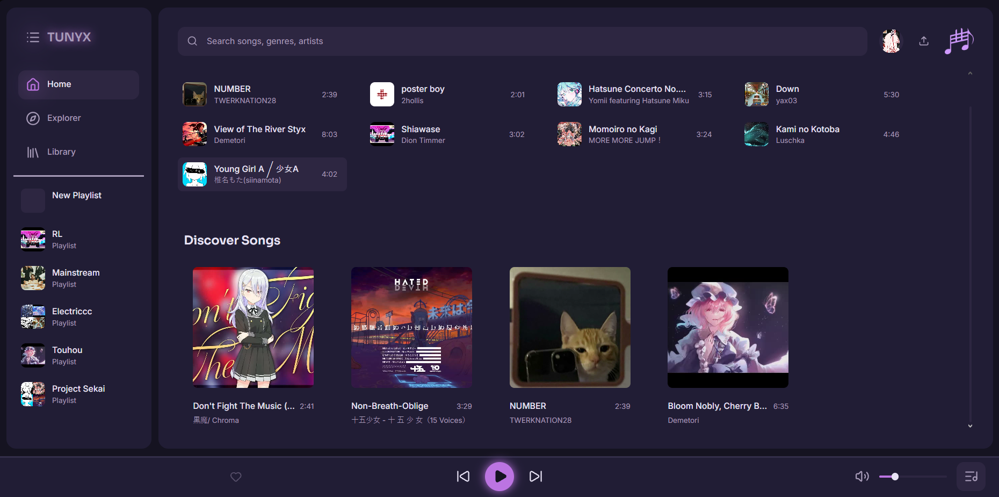
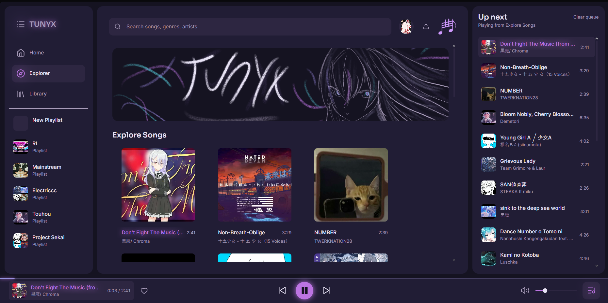
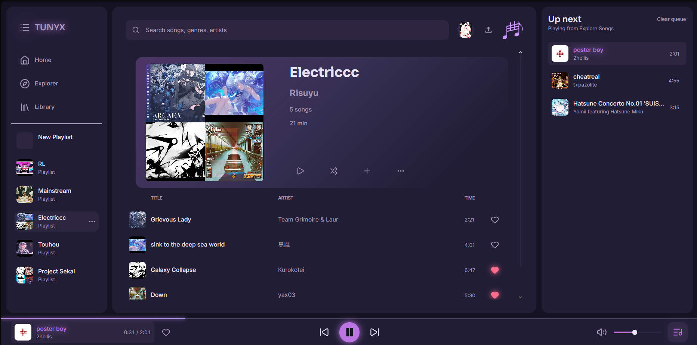

<div align="center">


---


### _Tune your experience._ 🎧

Upload your songs, build playlists, and watch a full-window equalizer react to the real audio spectrum.

**Build: Beta v1** · November 2026


</div>

---

> ⚠️ **Please read the [Legal notice](#%EF%B8%8F-legal-notice) before using, forking or hosting this project.**
> Tunyx is an educational, non-commercial college project. It ships with **no music and no media of any kind**, and anything uploaded to a running instance is the sole responsibility of the person who uploaded it.

## ✨ What is this?

Tunyx is a web music player we built as a group project for **Sistem Basis Data** and **UI/UX Design**. It started as a Java app in semester 2 and came back as a full web app with a dark, game-like interface.

No streaming catalog and no subscriptions: you upload your own songs and they become your library.

> 🧪 **This is a prototype, not a full-blown web app.** There is no real streaming service behind it. Songs are uploaded and played straight from the server's own `uploads/` folder, and it is built to run locally on XAMPP. It works end to end, but it is a Beta v1 made to show the idea and the experience, not to be deployed to the public.

## 🖼️ Screenshots

<table>
  <tr>
    <td width="50%">
      
      <p align="center"><b>Now Playing</b><br>The full-window visualizer, bass on the right</p>
    </td>
    <td width="50%">
      
      <p align="center"><b>Home</b><br>Listening history and discover songs</p>
    </td>
  </tr>
  <tr>
    <td width="50%">
      
      <p align="center"><b>Explore</b><br>Browse uploads, with the Up next queue open</p>
    </td>
    <td width="50%">
      
      <p align="center"><b>Playlists</b><br>Cover collage, actions and track list</p>
    </td>
  </tr>
</table>

<sub>The screenshots show the developers' own local test libraries and are included only to demonstrate the interface. Song titles and cover art belong to their respective owners. See the [Legal notice](#%EF%B8%8F-legal-notice).</sub>

## 🔥 Features

- 🔐 **Accounts:** register, sign in and out, change your username and profile photo (PHP sessions, bcrypt passwords)
- ⬆️ **Upload:** MP3, FLAC, WAV, OGG, M4A or AAC up to 100 MB, with title, artist, album, genre and cover. Mark a song public or private
- 🔎 **Browse and search:** Home, Explore, Library, Liked Songs, My Uploads, and live search by title, artist or genre
- 📚 **Playlists:** create, rename, change the cover, add and remove songs, delete
- ▶️ **Player:** queue panel (Up next), previous/next, volume, shuffle on playlists, a glowing seek line you can click, drag or move with the arrow keys, and `Space` to play or pause
- 🌈 **The visualizer:** 64 bars on the Web Audio API with the bass on the right, bars that swell on every kick, and a color gradient that keeps moving. The bars also light up as the song progresses

## 🧰 Tech stack

| Layer | What we used |
|---|---|
| Server | Apache + PHP 8, plain JSON endpoints in `api/` (PDO + sessions) |
| Database | MySQL (MariaDB via XAMPP), database `tunyx`, 8 InnoDB tables |
| Frontend | Vanilla JS ES modules, no build step, hash router, CSS design tokens |
| Audio | HTML `<audio>` + Web Audio `AnalyserNode`, drawn on a canvas |
| Look | Figma, Lucide icons, Sora + Inter fonts |

## 🚀 Run it locally

You need [XAMPP](https://www.apachefriends.org/).

1. Copy this project to `C:\xampp\htdocs\tunyx`.
2. In `php.ini` (XAMPP Control Panel > Apache > Config), set:
   ```ini
   upload_max_filesize=100M
   post_max_size=110M
   ```
3. Start **Apache** and **MySQL** in XAMPP (restart Apache if you edited `php.ini`).
4. Open phpMyAdmin (`http://localhost/phpmyadmin`) and import `db/mainschema.sql`. It creates the `tunyx` database and every table.
5. Go to **http://localhost/tunyx/**, create an account, and upload a few songs. A fresh clone starts empty.

The DB connection lives in `api/db.php` (`127.0.0.1`, user `root`, no password, database `tunyx`). Change it there if your setup is different. The `uploads/` folder is created automatically on your first upload.

> 💡 **For the visualizer:** click anywhere on the page once, then press play. Browsers only start Web Audio after a click.

> 🌐 The fonts come from Google Fonts, so you need internet for the full look.

<details>
<summary><b>Offline UI preview (?mock=1)</b></summary>

`http://localhost/tunyx/?mock=1` runs the interface on built-in sample data, with no PHP or MySQL. It is only a quick look at the UI: uploads and some account features don't work in this mode.

</details>

## 🗄️ Database

Eight tables, matching our ERD:

`users` · `artists` · `albums` · `tracks` · `playlists` · `playlist_tracks` · `likes` · `play_history`

Cascading deletes keep things clean: removing a user, track or playlist also removes its likes, history and playlist entries. Deleting an album only clears `tracks.album_id`. The full schema (keys, indexes, constraints) is in [`db/mainschema.sql`](db/mainschema.sql).

## 📁 Project structure

```
index.php              single page shell
api/                   PHP JSON endpoints (login, songs, upload, playlists, ...)
db/mainschema.sql      database schema
assets/css/            design tokens + one stylesheet per component
assets/img/            logo, banner and README screenshots
assets/js/
  main.js, router.js   boot, layout, hash routing
  api.js, store.js     fetch wrapper and shared state
  player.js            the single audio element, queue and history
  components/          sidebar, top bar, player bar, modals, visualizer, ...
  views/               home, explore, library, liked, uploads, playlist, now playing
uploads/               songs, covers, avatars (created at runtime, not in git)
LICENSE                GNU GPL v3 (source code)
THIRD_PARTY_NOTICES.md licenses of bundled and linked third-party components
```

## 🔌 API at a glance

Every endpoint answers `{ success, message, data }` with a matching HTTP status. Everything except `login` and `register` needs a signed-in session (otherwise 401).

| Endpoint | What it does |
|---|---|
| `register.php` `login.php` `logout.php` `me.php` | accounts and session |
| `profile.php` | change username or profile photo |
| `songs.php` | list and search (`q`, `genre`, `liked`, `mine`); POST `delete` removes your own song |
| `upload.php` | upload a song (multipart) |
| `like.php` | toggle a like |
| `playlists.php` | list, create, rename, change cover, delete |
| `playlists_tracks.php` | songs in a playlist: list, add, remove |
| `history.php` | record, list and clear play history |
| `albums.php` | list albums and details (not used by the UI) |

## 🩹 Troubleshooting

| Problem | Fix |
|---|---|
| "Can't reach the server" | Start Apache, and open the app through `http://localhost/tunyx/` |
| "Could not connect to the database" | Start MySQL and make sure `db/mainschema.sql` was imported |
| Upload fails on a big file | Check the `php.ini` limits in step 2, then restart Apache |
| Visualizer doesn't move | Click the page once, then press play |
| Layout feels cramped | It's designed for a 1440 px wide window. Under 1100 px the sidebar collapses and Up next becomes a drawer |

## ⚡ Fun fact

Tunyx was speedrun on a **2-week deadline**: concept, Figma design, database, PHP backend, frontend and the visualizer, all in two weeks.

## ⚖️ Legal notice

> This section is provided in good faith by the project's student authors. It is not legal advice.

### 🎓 Purpose and scope

Tunyx is a rushed, for-fun college mini project, built for coursework and released as-is for learning and reference. It is, and will remain, **strictly educational and non-commercial**: no ads, no payments, no subscriptions, no monetization of any kind by the authors.

It is a local prototype. It is **not** a hosted service, **not** a streaming platform, and not intended for production or public deployment.

### 🏷️ Name and branding

While preparing this release we found that the name **"Tunyx"** is also used by a few other websites and apps. Our research before choosing the name did not turn them up, so the overlap is unintentional. Tunyx has **no affiliation, association or endorsement** with any of them.

If you own a trademark or other rights in the name and would like us to rename the project or remove the branding, please get in touch and we will cooperate in good faith:

- Discord: **brisisfr**
- or open an issue on this repository

### 🎵 Music, content and copyright

- **Tunyx has no online library.** This repository contains **no songs, no audio files, no album art and no catalog** of any kind. The `uploads/` folder is created empty on your own machine and is excluded from version control.
- Every song, cover image or other file in a running instance was **added by the person running it**. Tunyx does not search for, fetch, stream or distribute third-party content.
- **If a copyrighted work is uploaded to an instance, the uploader (and whoever operates that instance) is solely responsible for it.** The authors do not host, review, endorse or have access to anyone's uploads, and accept no liability for them. Only upload files you own or have the right to use, for example your own recordings, Creative Commons or royalty-free music.
- If you choose to host a public instance, you become its operator and take on the legal responsibilities that come with that, including handling takedown requests for content uploaded to it.
- The screenshots in this README show the developers' own local test libraries and are used only to illustrate the interface. All song titles, artist names and cover art in them belong to their respective owners. If you are an artist or rights holder and want an image removed, contact us as above and we will take it down promptly, no questions asked.

### 📜 License

The **source code** is released under the [GNU General Public License v3.0](LICENSE) (GPL-3.0). You are free to use, study, modify and share it, but any distributed modified version must stay open source under the same license.

The GPL covers the code only. The **"Tunyx" name, logo and banner artwork** are not licensed for reuse and remain the property of their author, so forks are kindly asked to use a different name and logo. Being non-commercial is our own commitment as maintainers; it is not an extra restriction added to the license, which allows commercial use as the GPL always does.

Third-party components keep their own licenses (all compatible with the GPL), listed in [`THIRD_PARTY_NOTICES.md`](THIRD_PARTY_NOTICES.md): [Lucide](https://lucide.dev) icons (ISC) and the Sora and Inter fonts (SIL OFL, loaded from Google Fonts).

### 🔒 Security and privacy

Tunyx is a student project and has not been security audited. The default setup (database user `root` with no password, detailed error messages) is meant for a local XAMPP install only. Do not expose it to the internet as-is.

Everything you create (accounts, uploads, playlists) lives in your own local database and `uploads/` folder. The app has no analytics or tracking, but your browser loads fonts from Google Fonts.

### 🛡️ No warranty

Provided "as is", without warranty of any kind. The authors are not liable for any damages or losses arising from the use of this software. See the [LICENSE](LICENSE) for the full terms.

## 🙏 Special thanks

| Name | Role | Profile | 
|---|---|---|
| **Bris** | Project Lead · UI/UX Designer · Frontend Developer | [@brisisfr](https://github.com/brisisfr) | 
| **krabbyforry** | Lead Backend & Database Engineer | [@krabbyforry](https://github.com/krabbyforry) |
| **K**  | UI/UX Contributor · Documentation | - |
| **F**  | UI/UX Contributor · Documentation | - |
| **P**  | Documentation Lead | - |

<div align="center">

Made with way too much caffeine 💜

</div>
